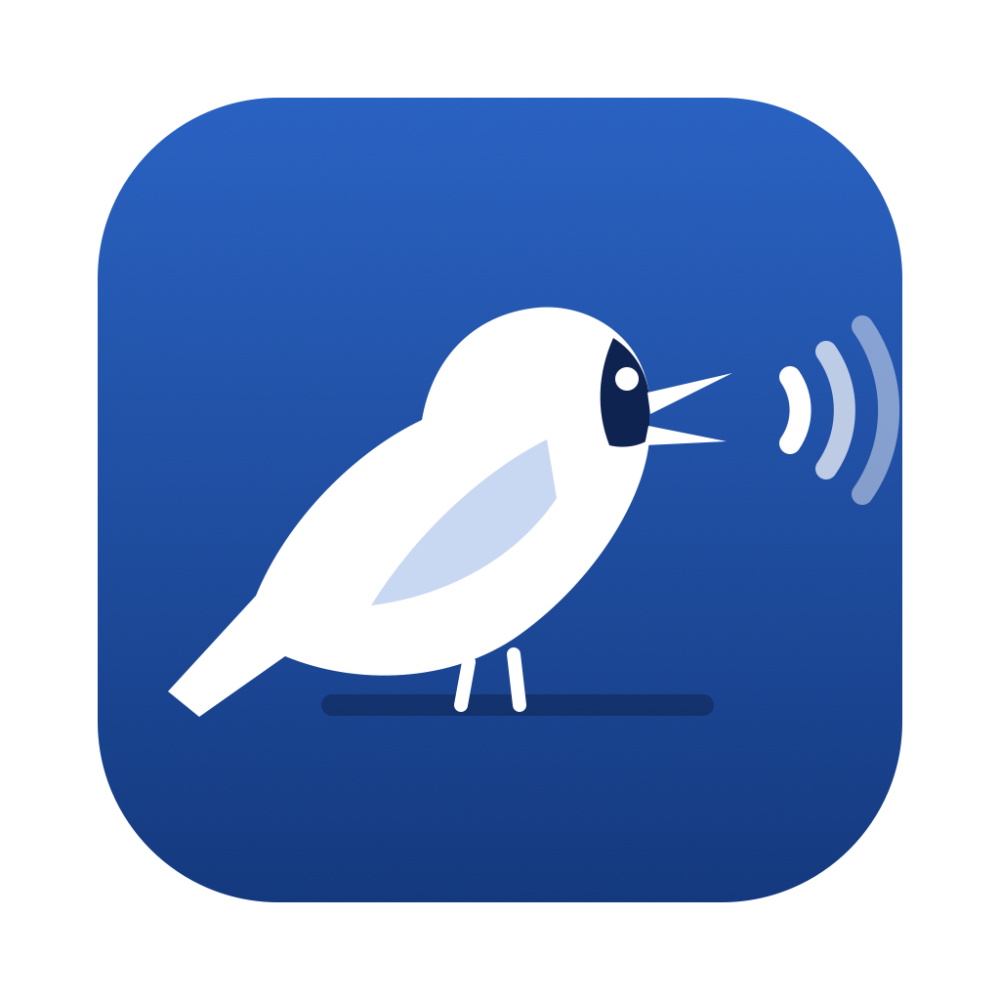

<p align="center"></p>

<h1 align="center">Oruri</h1>

<p align="center">Mantén pulsada una tecla, habla, y el texto aparece en la app del Mac que estés usando.</p>

<p align="center">
  
  
  
  
</p>

<p align="center"><a href="README.md">🇺🇸 English</a> · 🇪🇸 Español · <a href="README.pt-BR.md">🇧🇷 Português</a> · <a href="README.ja.md">🇯🇵 日本語</a></p>

Oruri es una app de dictado para macOS hecha en SwiftUI: mantén pulsada una tecla, habla, y el texto aparece en la app en la que estás escribiendo.
También transcribe los archivos de audio y vídeo que arrastras sobre ella, uno detrás de otro.

Un proyecto personal de portafolio, hecho con vibe coding junto con Claude Code. No se distribuye como app lista para usar:
compílala desde el código (ver Cómo empezar más abajo).

**Versión actual: 0.7.1** — las notas completas están en [CHANGELOG.md](CHANGELOG.md) (en inglés) y en Settings › Updates, dentro de la app.

El nombre viene de la ōruri (オオルリ), un pájaro azul y cantor de Japón; el nombre significa "gran lapislázuli".

## Cómo se hizo

Oruri es un proyecto personal de portafolio, hecho con vibe coding junto con Claude ([Claude Code](https://claude.com/claude-code))
para aprender cómo se comportan las herramientas de IA dentro de una app real. Yo describía lo que quería en lenguaje sencillo,
probaba cada versión en mi Mac y aprobaba cada cambio; Claude escribía el código. Por el camino:

- una hoja de ruta de 29 puntos, hechos uno a uno, de la idea a la versión terminada (de la 0.1.0 a la 0.7.1, ver [CHANGELOG.md](CHANGELOG.md));
- cada cambio pasa por `./qa.sh`: 59 pruebas automáticas (números escritos con letras, correcciones habladas, protecciones de la IA,
  detección de silencio…), una revisión de las traducciones en los 4 idiomas de la interfaz, la compilación y la app abriéndose;
- dos análisis de Claude Security, con todos los hallazgos confirmados corregidos (en la 0.5.7 y en la 0.7.1);
- decisiones basadas en mediciones reales, como las cabeceras de límite de Groq y la velocidad de Ollama en un Mac de 8 GB.

Es código abierto, bajo la GPL-3.0, y funciona con motores gratuitos: transcripción en el propio Mac, Groq con tu propia clave de API, y
Groq o un modelo local de Ollama para la limpieza con IA opcional. No hay descarga firmada ni versión de pago: compílala desde el
código (ver Cómo empezar).

## Funciones

- **Dictado en cualquier app** — mantén pulsada la tecla (fn por defecto) para hablar y suéltala para insertar el texto en la app activa.
  La tecla se elige por su nombre (Fn, Command, Option, Control, Shift) y, si quieres, por el lado (izquierdo, derecho o cualquiera),
  o puedes grabar un atajo combinado como ⌃⇧ o ⌃⇧D (cualquier tecla, salvo Esc, F1–F12, Backspace y Enter).
  Dos toques rápidos activan el modo manos libres; Esc cancela.
- **Motores de transcripción**
  - En el propio Mac, con `SpeechAnalyzer` + `SpeechTranscriber` de Apple (macOS 26+; en sistemas anteriores usa `SFSpeechRecognizer`) —
    texto ya puntuado, sin clave y sin que el audio salga del Mac.
  - En la nube: Groq (Whisper large v3 / turbo), con tu propia clave de API guardada en el Llavero.
- **Cola de archivos** — arrastra audios o vídeos (WAV, MP3, M4A, MP4, MOV…) a Inicio, elígelos con el botón de carpeta o usa *Abrir con › Oruri*;
  se convierten y se transcriben uno detrás de otro. Los archivos largos se comprimen antes de enviarlos a Groq (hasta ~1 h 40 min).
- **Tratamiento del texto** — puntuación hablada ("coma", "vírgula", "new line"…), eliminación de muletillas,
  números en cifras (portugués e inglés, incluidas versiones y decimales como 0.2.1) y un diccionario propio con corrección de palabras parecidas.
- **Correcciones habladas** — di la parte equivocada, una expresión de corrección y la parte correcta ("pro Pedro, errei, pro Paulo",
  "na quinta, quer dizer, na sexta") y solo queda la versión corregida. También funcionan varias correcciones seguidas; vale la última.
  Los casos simples se resuelven con reglas fijas, sin IA.
- **Limpieza con IA (opcional)** — Groq (rápida, en la nube, la misma clave de la transcripción) o un modelo local de Ollama limpia cada texto dictado.
  Solo puede arreglar puntuación, mayúsculas y ortografía y aplicar las correcciones habladas; si cambia un número, un nombre, una negación
  o una palabra, quita parte de la frase o la reescribe, se mantiene la transcripción original. Con Groq, "Improve sentences" permite
  reescribir frases confusas siempre que el sentido no cambie (una segunda consulta a Groq lo comprueba).
- **Entrega** — pega con ⌘V o escribe en cualquier app donde se pueda escribir, incluidas las hechas con Electron y Chromium
  (Claude, ChatGPT, Chrome, Slack); mantiene o restaura el portapapeles; muestra "Copied · ⌘V" en la burbuja de grabación
  cuando no hay dónde pegar o falta el permiso de Accesibilidad; las grabaciones muy largas solo se copian y el texto llega literal en apps de IA y terminales.
- **Audio sin voz** — las grabaciones y archivos sin voz se detectan por el volumen y se descartan en lugar de transcribirse.
- **Iniciar en la barra de menús** — opcional: se abre sin ventana y se queda en el Dock y en la barra de menús.
- **Interfaz** — barra lateral con Inicio, Historial, Uso y Ayuda (se abre al pasar el ratón y muestra los nombres; el botón de menú
  la deja abierta); en Inicio, una línea de canto que se mueve con tu voz (haz clic para grabar), selectores de micrófono y de
  modelo y los últimos dictados en tipografía serif, como un cuaderno; Settings en un panel con secciones desplegables; Dictionary, Pro,
  apariencia (System, Light, Dark) y Settings en la barra superior; Uso con barras de límite y costes; Ayuda con preguntas
  frecuentes, guía de cada pantalla, búsqueda y contacto.
- **Idiomas** — la interfaz en English, Español, Português o 日本語 (Settings › Advanced › Language), cambiando al
  momento; inglés por defecto. Las traducciones están en `Localization/translations.txt`.
- **Historial** — muestra lo que oyó el reconocedor ("Heard: …") cuando es distinto del texto final; guardado en el Mac, con búsqueda, opción de reintentar transcripciones fallidas, límites de retención y un comando de shell posterior a la grabación.

## Privacidad

- Con el motor del propio Mac y Ollama, nada sale de tu Mac.
- Con Groq, el audio grabado (y, en la limpieza con IA, el texto) se envía a Groq con tu propia clave de API.
- Las claves de API se guardan en el Llavero de macOS, nunca en archivos ni en el código. El historial y las grabaciones se quedan en
  `~/Library/Application Support/Oruri`, con límites de retención y un botón para borrarlo todo.

## Cómo empezar

### Requisitos

- macOS 14 o posterior, preferiblemente con Apple silicon
- Swift 5.9+ (Xcode o las Command Line Tools)

### Compilar y abrir

1. Clona el repositorio y compila la app:

   ```bash
   git clone https://github.com/dev-seiji/oruri-app.git
   cd oruri-app
   ./build-app.sh && open build/Oruri.app
   ```

2. Sigue la bienvenida: concede Micrófono, Accesibilidad (para que Oruri pueda pegar) y Reconocimiento de voz, y elige la tecla de dictado.
3. Opcional: añade una [clave gratuita de Groq](https://console.groq.com/keys) en Settings › Models para una transcripción y limpieza con IA rápidas en la nube,
   o instala [Ollama](https://ollama.com) para una limpieza con IA que se queda en tu Mac.
4. Mantén pulsada fn y habla.

Para comprobarlo todo después de un cambio, ejecuta `./qa.sh`: pruebas, revisión de traducciones, compilación y la app abriéndose.

macOS vincula los permisos de Micrófono, Reconocimiento de voz y Accesibilidad a la firma de la app. `build-app.sh` firma con el primer
certificado local de firma de código cuyo nombre termine en **Local Signing** (por ejemplo *Oruri Local Signing*) si hay uno en tu Llavero,
así los permisos se mantienen entre compilaciones; si no, usa una firma ad hoc y macOS volverá a pedirlos tras cada compilación.

Durante el desarrollo también puedes usar `swift run`.

> Sin Xcode completo, la macro `@State` de SwiftUI no se puede expandir, por eso el proyecto usa `@LocalState`
> (`Sources/Oruri/LocalState.swift`), un sustituto equivalente hecho con `StateObject`.

## Estructura del proyecto

| Ruta | Qué es |
|---|---|
| `Sources/Oruri/OruriApp.swift` | Inicio de la app, ventanas y barra de menús |
| `Sources/Oruri/AppState.swift` | Estado observable de la app y los `Settings` |
| `Sources/Oruri/Store.swift` | Ajustes, historial y diccionario guardados; claves de API en el Llavero |
| `Sources/Oruri/AudioRecorder.swift` | Grabación del micrófono en WAV mono a 16 kHz, elección del micrófono |
| `Sources/Oruri/Usage.swift` | Uso de Groq contado en el Mac, límites del plan gratuito y precios |
| `Sources/Oruri/Transcription.swift` | Transcripción en el Mac y en la nube, conversión de archivos de audio y vídeo |
| `Sources/Oruri/TextPipeline.swift` | Puntuación hablada, muletillas, diccionario, números |
| `Sources/Oruri/LLMCleanup.swift` | Limpieza opcional con Groq u Ollama, con protección de seguridad |
| `Sources/Oruri/Delivery.swift` | Pegar/escribir en la app activa, teclas multimedia, abrir al iniciar sesión, comando posterior a la grabación |
| `Sources/Oruri/HotkeyMonitor.swift` | Teclas de dictado globales (mantener para hablar / doble toque) |
| `Sources/Oruri/DictationController.swift` | Coordina grabar → transcribir → limpiar → entregar → historial |
| `Sources/Oruri/ContentView.swift` | Ventana principal, barra lateral, barra superior, botón de apariencia, ventana Pro |
| `Sources/Oruri/HomeView.swift` | Inicio: línea de canto, números, últimos dictados, historial completo |
| `Sources/Oruri/DictionaryView.swift` | Diccionario propio |
| `Sources/Oruri/SettingsView.swift` | Panel de ajustes, sus secciones, Uso y Ayuda |
| `Sources/Oruri/OnboardingView.swift` | Primer uso |
| `Sources/Oruri/RecordingIndicator.swift` | Burbuja de grabación: icono de la app y líneas de la voz, encima del Dock |
| `Sources/Oruri/OllamaService.swift` | Comprueba si Ollama está en marcha y lo inicia sin Terminal |
| `Sources/Oruri/Theme.swift` | Paleta de colores |
| `Sources/Oruri/Localization.swift` | Idiomas de la interfaz: `T("…")` busca la traducción, el inglés es la clave |
| `Tests/OruriTests/` | Pruebas automáticas (Swift Testing), ejecutadas por `./qa.sh` |
| `qa.sh` | QA tras cada cambio: pruebas, traducciones, compilación y apertura |
| `Localization/` | `translations.txt` (todos los textos en es, pt, ja) y `build.py`, que genera y revisa los JSON |
| `Icon/` | Fuentes del icono (`oruri.svg` y `oruri-small.svg` para 16–32 px), la silueta de la barra de menús y el `AppIcon.icns` generado |

## Paleta

Basada en el ruri-iro (瑠璃色), el azul lapislázuli tradicional japonés que da nombre a la ōruri. Valores en modo claro / oscuro.

| Papel | Token | Hex |
|---|---|---|
| Principal (azul ruri) | `brand` | `#1E50A2` / `#6E95E0` |
| Azul marino, texto destacado | `brandDeep` | `#0F2350` / `#BCD0F5` |
| Azul suave, elemento seleccionado | `brandSoft` | `#E6EDF8` / `#17233D` |
| Dorado, Pro y detalles | `highlight` | `#C99A1E` / `#E3B94A` |
| Fondo | `contentBackground` | `#FFFFFF` / `#0D1220` |
| Superficie | `statsBackground` | `#F4F6FA` / `#161D2E` |
| Texto principal | `primaryText` | `#1A1F2B` / `#E8ECF4` |
| Texto secundario | `secondaryText` | `#5D6573` / `#A2ABBC` |
| Grabando | `recording` | `#D94A3D` / `#E5675B` |

## Agradecimientos

- El framework Speech de Apple (`SpeechAnalyzer` y `SFSpeechRecognizer`), para la transcripción en el propio Mac
- [Groq](https://groq.com), por la transcripción rápida con Whisper y los modelos de texto
- [Ollama](https://ollama.com), para ejecutar la limpieza con IA en local
- [Claude Code](https://claude.com/claude-code), el compañero de programación con IA con el que se hizo esta app con vibe coding

## Cómo contribuir

Los informes de errores y las sugerencias son bienvenidos como issues; por ahora no se aceptan pull requests de código. Ver [CONTRIBUTING.md](CONTRIBUTING.md).
Fallos de seguridad: ver [SECURITY.md](SECURITY.md).

## Licencia

[GPL-3.0](LICENSE).
