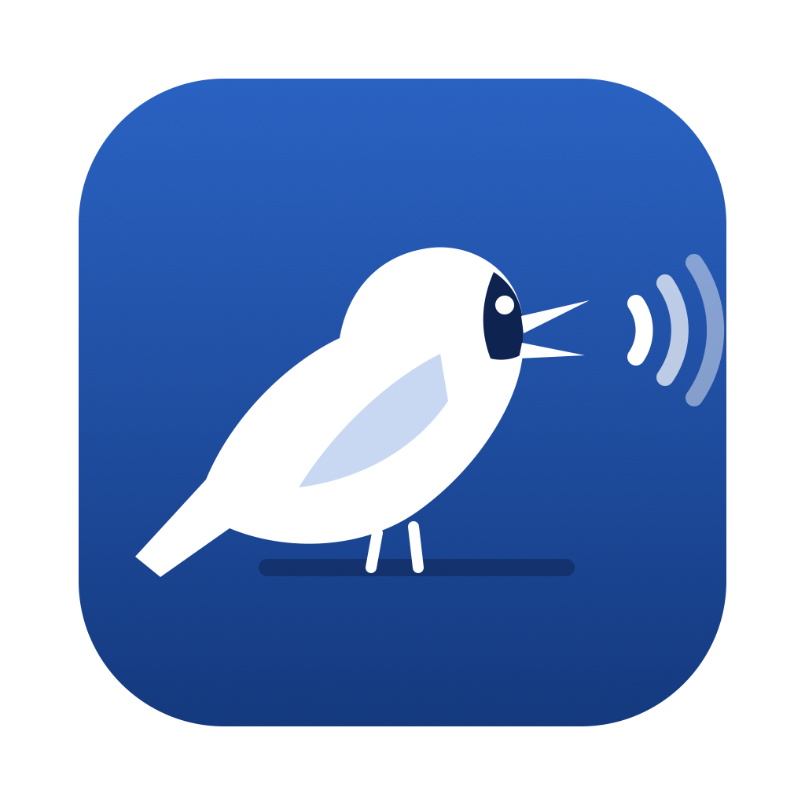

<p align="center"></p>

<h1 align="center">Oruri</h1>

<p align="center">キーを押したまま話すと、いま使っている Mac のアプリに文字が入ります。</p>

<p align="center">
  
  
  
  
</p>

<p align="center"><a href="README.md">🇺🇸 English</a> · <a href="README.es.md">🇪🇸 Español</a> · <a href="README.pt-BR.md">🇧🇷 Português</a> · 🇯🇵 日本語</p>

Oruri は SwiftUI で作った macOS 用の音声入力アプリです。キーを押したまま話すと、入力中のアプリに文字が入ります。
ドラッグした音声・動画ファイルも、1 本ずつ順番に文字起こしします。

個人のポートフォリオ用プロジェクトで、Claude Code とのバイブコーディングで作りました。完成版のアプリは配布していないので、
ソースからビルドしてください（下の「はじめかた」を参照）。

**現在のバージョン: 0.7.1** — すべての変更履歴は [CHANGELOG.md](CHANGELOG.md)（英語）と、アプリの Settings › Updates にあります。

名前は日本の青い鳥・オオルリから。「大きな瑠璃」という意味です。

## 作り方

Oruri は個人のポートフォリオ用プロジェクトで、AI ツールが実際のアプリの中でどう動くかを学ぶために、Claude（[Claude Code](https://claude.com/claude-code)）と
バイブコーディングで作りました。私がやりたいことを普通の言葉で伝え、各バージョンを自分の Mac で試して、変更をひとつずつ承認し、
コードは Claude が書きました。その過程で:

- 29 項目のロードマップを、アイデアから完成まで 1 つずつ進めました（0.1.0 から 0.7.1 まで。[CHANGELOG.md](CHANGELOG.md) を参照）。
- すべての変更は `./qa.sh` を通します: 59 個の自動テスト（数字の読み、話し言葉での言い直し、AI の安全チェック、無音の検出など）、
  4 つの表示言語の翻訳チェック、ビルド、アプリの起動確認。
- Claude Security のスキャンを 2 回行い、確認された問題はすべて修正しました（0.5.7 と 0.7.1）。
- Groq のレート制限ヘッダーや、8 GB の Mac での Ollama の速度など、実際の計測をもとに判断しました。

GPL-3.0 のオープンソースで、無料のエンジンで動きます: Mac 上での文字起こし、自分の API キーを使う Groq、そして AI 整形（任意）には
Groq かローカルの Ollama。署名済みのダウンロードも有料版もないので、ソースからビルドしてください（「はじめかた」を参照）。

## 機能

- **どのアプリでも音声入力** — キー（標準は fn）を押したまま話し、離すと入力中のアプリに文字が入ります。
  キーは名前（Fn、Command、Option、Control、Shift）と、必要なら左右（左、右、どちらでも）で選べます。
  ⌃⇧ や ⌃⇧D のような組み合わせショートカットも登録できます（Esc、F1–F12、Backspace、Enter 以外のキー）。
  2 回すばやく押すとハンズフリー、Esc で取り消し。
- **文字起こしエンジン**
  - Mac 上で、Apple の `SpeechAnalyzer` + `SpeechTranscriber`（macOS 26 以降。それより前は `SFSpeechRecognizer`）—
    句読点つきの文字、キー不要、音声は Mac の外に出ません。
  - クラウド: Groq（Whisper large v3 / turbo）。自分の API キーをキーチェーンに保存して使います。
- **ファイルのキュー** — 音声・動画（WAV、MP3、M4A、MP4、MOV など）をホームにドラッグするか、フォルダボタンで選ぶか、*このアプリで開く › Oruri* を使います。
  1 本ずつ変換して文字起こしします。長いファイルは Groq に送る前に圧縮します（約 1 時間 40 分まで）。
- **テキスト処理** — 話した句読点（"comma"、"vírgula"、"new line" など）、つなぎ言葉の削除、
  数字の算用数字化（ポルトガル語と英語。0.2.1 のようなバージョンや小数にも対応）、似た綴りを直す自分用の辞書。
- **話し言葉での言い直し** — 間違えた部分、言い直しの言葉、正しい部分を続けて言うと（"pro Pedro, errei, pro Paulo" など）、
  直した方だけが残ります。何度続けて言い直しても、最後のものが有効です。簡単なケースは AI を使わない固定ルールで処理します。
- **AI による整形（任意）** — Groq（高速、クラウド、文字起こしと同じキー）かローカルの Ollama が、音声入力したすべての文章を整えます。
  直せるのは句読点、大文字小文字、綴り、言い直しの反映だけで、数字・名前・否定・単語を変えたり、文を削ったり書き換えたりした場合は
  元の文字起こしを残します。Groq では「Improve sentences」で、意味が変わらない範囲でわかりにくい文を書き直せます（Groq への 2 回目の確認で意味をチェック）。
- **入力の届け方** — ⌘V で貼り付けるか 1 文字ずつ入力します。Electron や Chromium のアプリ（Claude、ChatGPT、Chrome、Slack）も含め、
  文字を書けるどのアプリでも使えます。クリップボードは残すか元に戻すか選べます。貼り付け先がないときやアクセシビリティの許可がないときは、
  録音バブルに「Copied · ⌘V」を表示します。とても長い録音はコピーだけにし、AI アプリやターミナルでは話したとおりに入力します。
- **無音の音声** — 声の入っていない録音やファイルは音量で判定し、文字起こしせずに捨てます。
- **メニューバーで起動** — 任意: ウインドウを開かずに起動し、Dock とメニューバーに常駐します。
- **画面** — ホーム、履歴、使用状況、ヘルプのサイドバー（マウスを乗せると開いて名前を表示、メニューボタンで開いたまま）。
  ホームには声に合わせて動く「さえずりの線」（クリックで録音）、マイクとモデルの選択、ノートのようなセリフ体で並ぶ最近の入力。
  Settings はセクションが開閉する引き出し。上部のバーに Dictionary、Pro、外観（System、Light、Dark）、Settings。
  使用状況には上限のバーと費用、ヘルプにはよくある質問、各画面の案内、検索、連絡先。
- **言語** — 画面は English、Español、Português、日本語（Settings › Advanced › Language）で、その場で切り替わります。
  標準は英語。翻訳は `Localization/translations.txt` にあります。
- **履歴** — 最終的な文章と違うときは、認識された内容（"Heard: …"）も表示。Mac に保存され、検索、失敗した文字起こしの再試行、保存期間の上限、録音後のシェルコマンドに対応。

## プライバシー

- Mac 上のエンジンと Ollama を使う場合、何も Mac の外に出ません。
- Groq を使う場合、録音した音声（AI 整形では文章も）を、あなた自身の API キーで Groq に送ります。
- API キーは macOS のキーチェーンに保存し、ファイルやコードには入れません。履歴と録音は
  `~/Library/Application Support/Oruri` に保存され、保存期間の上限とすべて削除するボタンがあります。

## はじめかた

### 必要な環境

- macOS 14 以降（Apple シリコン推奨）
- Swift 5.9 以降（Xcode または Command Line Tools）

### ビルドして起動

1. リポジトリをクローンしてアプリをビルドします:

   ```bash
   git clone https://github.com/dev-seiji/oruri-app.git
   cd oruri-app
   ./build-app.sh && open build/Oruri.app
   ```

2. 最初の案内に従って、マイク、アクセシビリティ（Oruri が貼り付けるため）、音声認識を許可し、音声入力のキーを選びます。
3. 任意: 高速なクラウドの文字起こしと AI 整形には、Settings › Models に[無料の Groq API キー](https://console.groq.com/keys)を入れます。
   Mac の中だけで AI 整形をするなら [Ollama](https://ollama.com) をインストールします。
4. fn を押したまま話します。

変更後にすべて確認するには `./qa.sh` を実行します: テスト、翻訳チェック、ビルド、アプリの起動確認。

macOS はマイク、音声認識、アクセシビリティの許可をアプリの署名に結びつけます。`build-app.sh` は、キーチェーンに名前が **Local Signing** で終わる
ローカルのコード署名証明書（例: *Oruri Local Signing*）があれば最初のものを使って署名するので、ビルドし直しても許可は残ります。
なければアドホック署名になり、ビルドのたびに macOS が許可を求めます。

開発中は `swift run` も使えます。

> Xcode をすべて入れていないと SwiftUI の `@State` マクロを展開できないため、このプロジェクトは `@LocalState`
> （`Sources/Oruri/LocalState.swift`）という、`StateObject` で作った同等の代わりを使っています。

## プロジェクトの構成

| パス | 内容 |
|---|---|
| `Sources/Oruri/OruriApp.swift` | アプリの起動、ウインドウ、メニューバー |
| `Sources/Oruri/AppState.swift` | アプリの状態と `Settings` |
| `Sources/Oruri/Store.swift` | 設定・履歴・辞書の保存、API キーはキーチェーン |
| `Sources/Oruri/AudioRecorder.swift` | マイクから 16 kHz モノラル WAV への録音、マイクの選択 |
| `Sources/Oruri/Usage.swift` | Mac で数えた Groq の使用量、無料プランの上限と料金 |
| `Sources/Oruri/Transcription.swift` | Mac 上とクラウドの文字起こし、音声・動画ファイルの変換 |
| `Sources/Oruri/TextPipeline.swift` | 話した句読点、つなぎ言葉、辞書、数字 |
| `Sources/Oruri/LLMCleanup.swift` | Groq か Ollama による任意の整形と安全チェック |
| `Sources/Oruri/Delivery.swift` | 入力中のアプリへの貼り付け・入力、メディアキー、ログイン時に開く、録音後のコマンド |
| `Sources/Oruri/HotkeyMonitor.swift` | 全体で使える音声入力キー（押したまま話す / 2 回押し） |
| `Sources/Oruri/DictationController.swift` | 録音 → 文字起こし → 整形 → 入力 → 履歴の流れをまとめる |
| `Sources/Oruri/ContentView.swift` | メインウインドウ、サイドバー、上部バー、外観ボタン、Pro ウインドウ |
| `Sources/Oruri/HomeView.swift` | ホーム: さえずりの線、数字、最近の入力、履歴の一覧 |
| `Sources/Oruri/DictionaryView.swift` | 自分用の辞書 |
| `Sources/Oruri/SettingsView.swift` | 設定の引き出しと各セクション、使用状況、ヘルプ |
| `Sources/Oruri/OnboardingView.swift` | 最初の案内 |
| `Sources/Oruri/RecordingIndicator.swift` | Dock の上に出る録音バブル: アプリのアイコンと声の線 |
| `Sources/Oruri/OllamaService.swift` | Ollama が動いているか確認し、ターミナルなしで起動 |
| `Sources/Oruri/Theme.swift` | 配色 |
| `Sources/Oruri/Localization.swift` | 画面の言語: `T("…")` が翻訳を探し、英語がキー |
| `Tests/OruriTests/` | 自動テスト（Swift Testing）。`./qa.sh` で実行 |
| `qa.sh` | 変更ごとの QA: テスト、翻訳、ビルド、起動 |
| `Localization/` | `translations.txt`（es、pt、ja の全テキスト）と、JSON を生成・確認する `build.py` |
| `Icon/` | アイコンの元データ（`oruri.svg` と 16–32 px 用の `oruri-small.svg`）、メニューバーのシルエット、生成された `AppIcon.icns` |

## 配色

オオルリの名前の由来である、日本の伝統色・瑠璃色がもとです。値はライト / ダーク。

| 役割 | トークン | Hex |
|---|---|---|
| メイン（瑠璃色） | `brand` | `#1E50A2` / `#6E95E0` |
| 紺、強調する文字 | `brandDeep` | `#0F2350` / `#BCD0F5` |
| 淡い青、選択中の項目 | `brandSoft` | `#E6EDF8` / `#17233D` |
| 金、Pro と細部 | `highlight` | `#C99A1E` / `#E3B94A` |
| 背景 | `contentBackground` | `#FFFFFF` / `#0D1220` |
| 面 | `statsBackground` | `#F4F6FA` / `#161D2E` |
| 本文 | `primaryText` | `#1A1F2B` / `#E8ECF4` |
| 補足の文字 | `secondaryText` | `#5D6573` / `#A2ABBC` |
| 録音中 | `recording` | `#D94A3D` / `#E5675B` |

## 謝辞

- Mac 上での文字起こしに使った Apple の Speech フレームワーク（`SpeechAnalyzer` と `SFSpeechRecognizer`）
- Whisper による高速な文字起こしとテキストモデルを提供する [Groq](https://groq.com)
- AI 整形をローカルで動かすための [Ollama](https://ollama.com)
- このアプリをバイブコーディングで一緒に作った AI プログラミングパートナー、[Claude Code](https://claude.com/claude-code)

## 貢献について

バグ報告や提案は issue で歓迎します。コードの pull request は今のところ受け付けていません。[CONTRIBUTING.md](CONTRIBUTING.md) を参照してください。
セキュリティの問題は [SECURITY.md](SECURITY.md) を参照してください。

## ライセンス

[GPL-3.0](LICENSE)。
