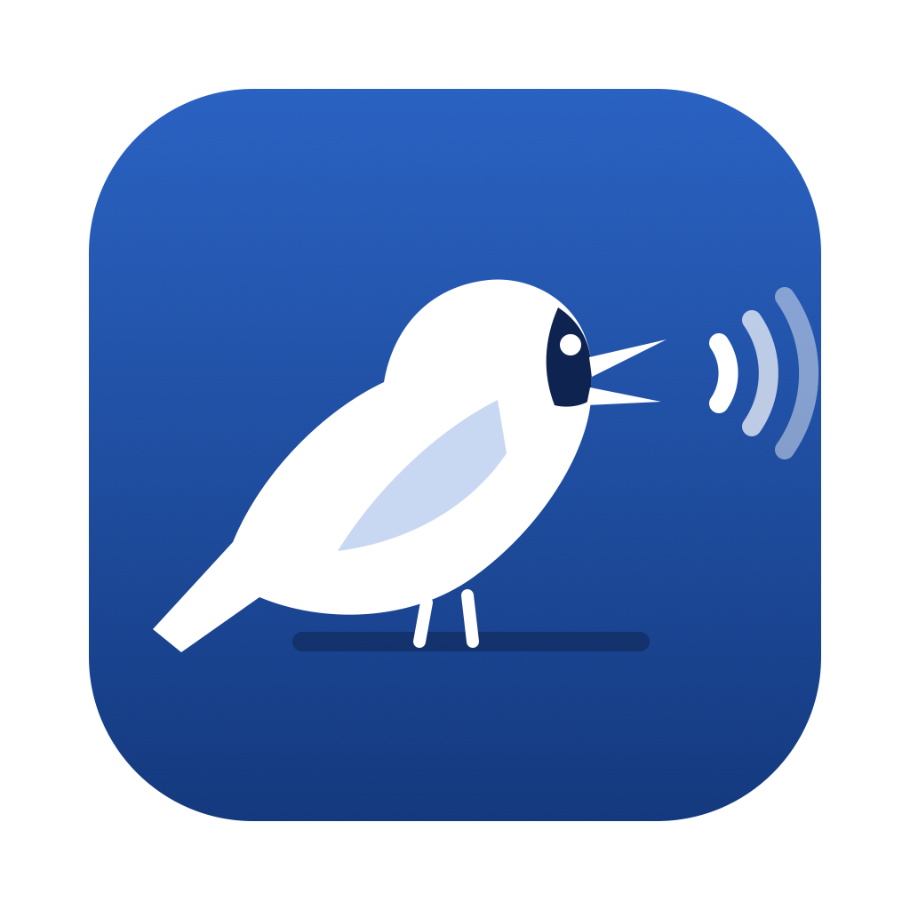

<p align="center"></p>

<p align="center">🇺🇸 English · <a href="README.pt-BR.md">🇧🇷 Português</a></p>

# Oruri

Oruri is a macOS dictation app written in SwiftUI: hold a key, talk, and the text lands in whatever app you're using.
It also transcribes audio and video files you drop on it, one after another.

It's a personal portfolio project: a voice-to-text app for the Mac, vibe coded with Claude (Claude Code) to learn how AI tools
work in a real app, from speech recognition to AI text cleanup with safety checks. It isn't distributed as a ready-made app;
to use it, build it from the source (see Build below).

**Current version: 0.6.6** — see Settings › Updates in the app for the full release notes.

Oruri is named after the ōruri (オオルリ), a blue songbird from Japan whose name means "great lapis lazuli".

## About this project

Oruri is open source under the GPL-3.0. It builds and runs with free engines: on-device transcription, Groq with your own
API key, and Groq or a local Ollama model for the optional AI cleanup. There is no signed download and no paid version:
build it with `./build-app.sh`.

## Features

- **Dictation anywhere** — hold your key (fn by default) to talk, release to insert the text in the focused app.
  Pick the key by name (Fn, Command, Option, Control, Shift) and, if you want, the side (left, right or either),
  or record a combined shortcut such as ⌃⇧ or ⌃⇧D (any key except Esc, F1–F12, Backspace and Enter).
  Double-tap for hands-free mode; Esc cancels.
- **Transcription engines**
  - On-device with Apple's `SpeechAnalyzer` + `SpeechTranscriber` (macOS 26+, falls back to `SFSpeechRecognizer` on older systems) —
    punctuated text, no key needed, audio never leaves the Mac.
  - Cloud: Groq (Whisper large v3 / turbo) with your own API key, stored in the Keychain.
- **File queue** — drop audio or video files (WAV, MP3, M4A, MP4, MOV…) on Home, pick them with the folder button, or use *Open With › Oruri*;
  they're converted and transcribed one after another.
- **Text pipeline** — spoken punctuation ("comma", "vírgula", "new line"…), filler-word removal, numbers as digits
  (English and Portuguese, including versions and decimals such as 0.2.1), a custom dictionary with sound-alike correction.
- **Spoken corrections** — say the wrong part, a correction phrase and the right part ("pro Pedro, errei, pro Paulo",
  "na quinta, quer dizer, na sexta", "…amanhã, né? Não, amanhã, depois de amanhã") and only the corrected version is kept.
  Several corrections in a row work too; the last one wins. Simple cases are handled by fixed rules, with no AI.
- **AI cleanup (optional)** — Groq (fast, in the cloud, same key as transcription) or a local Ollama model cleans every dictated text. It may only fix punctuation, capitals and spelling and apply spoken
  corrections; if it changes a number, name, negation or word, drops part of the sentence or rewrites it, the transcript is kept.
- **Delivery** — paste with ⌘V or type into any app you can write in, including Electron and Chromium apps
  (Claude, ChatGPT, Chrome, Slack); keep or restore the clipboard; a "Copied · ⌘V" notice in the recording bubble
  when there's nowhere to paste or Accessibility is off; very long recordings are only copied; verbatim mode in AI and terminal apps.
- **Blank audio** — recordings and files with no speech are detected by their volume and dropped instead of transcribed.
- **Start in the menu bar** — optional: open without the window, staying in the Dock and the menu bar.
- **Interface** — the microphone in the middle of the window, with microphone and model pickers below it, recent
  transcriptions as cards and a full history behind See all; Settings in a drawer with expandable sections;
  an appearance button (System, Light, Dark) in the top bar; a Usage section with limit bars and costs; a Help section with FAQ, a guide to each screen, search and contact; animations on open and close.
- **Languages** — the interface in English, Español, Português or 日本語 (Settings › Advanced › Language), switching
  on the spot; English by default. Translations live in `Localization/translations.txt`.
- **History** — shows what the recognizer heard ("Heard: …") when it differs from the final text; saved locally, searchable, retry failed transcriptions, retention limits, post-record shell hook.

## Requirements

- macOS 14 or later, Apple silicon recommended
- Swift 5.9+ (Xcode or the Command Line Tools)

## Build

```bash
./build-app.sh && open build/Oruri.app
```

macOS ties Microphone, Speech Recognition and Accessibility permissions to the app's signature. `build-app.sh` signs
with the first local code-signing certificate whose name ends in **Local Signing** (for example *Oruri Local Signing*) when one exists in your keychain, so permissions survive rebuilds;
otherwise it falls back to ad-hoc signing and macOS will ask again after every build.

During development you can also use `swift run`.

> Without a full Xcode install, SwiftUI's `@State` macro can't be expanded, so the project uses `@LocalState`
> (`Sources/Oruri/LocalState.swift`), a drop-in replacement built on `StateObject`.

## Project layout

| Path | What it is |
|---|---|
| `Sources/Oruri/OruriApp.swift` | App entry point, windows and menu bar |
| `Sources/Oruri/AppState.swift` | Observable app state and `Settings` |
| `Sources/Oruri/Store.swift` | Settings, history and dictionary persistence; Keychain for API keys |
| `Sources/Oruri/AudioRecorder.swift` | Microphone capture to 16 kHz mono WAV, input device selection |
| `Sources/Oruri/Usage.swift` | Groq usage counted on this Mac, free-plan limits and prices |
| `Sources/Oruri/Transcription.swift` | On-device and cloud transcription, audio/video file conversion |
| `Sources/Oruri/TextPipeline.swift` | Spoken punctuation, fillers, dictionary, number words |
| `Sources/Oruri/LLMCleanup.swift` | Optional Groq or Ollama cleanup with a safety check |
| `Sources/Oruri/Delivery.swift` | Paste/type into the focused app, media keys, launch at login, post-record hook |
| `Sources/Oruri/HotkeyMonitor.swift` | Global hold-to-talk / double-tap trigger keys |
| `Sources/Oruri/DictationController.swift` | Orchestrates record → transcribe → clean → deliver → history |
| `Sources/Oruri/ContentView.swift` | Main window, top bar, appearance button, Pro window |
| `Sources/Oruri/HomeView.swift` | Home: microphone, stats, recent cards, full history |
| `Sources/Oruri/DictionaryView.swift` | Custom dictionary |
| `Sources/Oruri/SettingsView.swift` | Settings drawer, its sections and Help |
| `Sources/Oruri/OnboardingView.swift` | First-run onboarding |
| `Sources/Oruri/RecordingIndicator.swift` | Recording bubble: app icon and voice lines, above the Dock |
| `Sources/Oruri/OllamaService.swift` | Checks whether Ollama is running and starts it without the Terminal |
| `Sources/Oruri/Theme.swift` | Color palette |
| `Sources/Oruri/Localization.swift` | Interface languages: `T("…")` looks up the translation, English is the key |
| `Tests/OruriTests/` | Automated tests (Swift Testing), run by `./qa.sh` |
| `qa.sh` | QA after every change: tests, translations, build, launch |
| `Localization/` | `translations.txt` (all texts in es, pt, ja), `build.py` to generate and check the JSON files |
| `Icon/` | App icon sources (`oruri.svg`, `oruri-small.svg` for 16–32 px), the menu bar silhouette and the generated `AppIcon.icns` |

## Palette

Based on ruri-iro (瑠璃色), the traditional Japanese lapis lazuli blue the ōruri is named after. Light / dark values.

| Role | Token | Hex |
|---|---|---|
| Primary (ruri blue) | `brand` | `#1E50A2` / `#6E95E0` |
| Navy, highlighted text | `brandDeep` | `#0F2350` / `#BCD0F5` |
| Soft blue, selected item | `brandSoft` | `#E6EDF8` / `#17233D` |
| Gold, Pro and details | `highlight` | `#C99A1E` / `#E3B94A` |
| Background | `contentBackground` | `#FFFFFF` / `#0D1220` |
| Surface | `statsBackground` | `#F4F6FA` / `#161D2E` |
| Primary text | `primaryText` | `#1A1F2B` / `#E8ECF4` |
| Secondary text | `secondaryText` | `#5D6573` / `#A2ABBC` |
| Recording | `recording` | `#D94A3D` / `#E5675B` |

## Contributing

Bug reports and suggestions are welcome as issues; code pull requests aren't accepted for now. See [CONTRIBUTING.md](CONTRIBUTING.md).
Security issues: see [SECURITY.md](SECURITY.md).

## License

[GPL-3.0](LICENSE).
