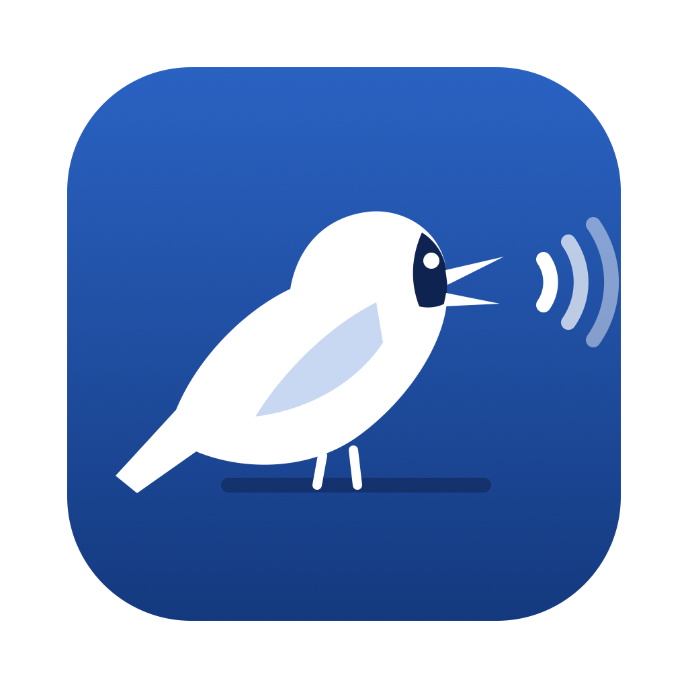

<p align="center"></p>

<h1 align="center">Oruri</h1>

<p align="center">Segure uma tecla, fale, e o texto aparece no app do Mac em que você está.</p>

<p align="center">
  
  
  
  
</p>

<p align="center"><a href="README.md">🇺🇸 English</a> · <a href="README.es.md">🇪🇸 Español</a> · 🇧🇷 Português · <a href="README.ja.md">🇯🇵 日本語</a></p>

O Oruri é um app de ditado para macOS feito em SwiftUI: segure uma tecla, fale, e o texto aparece no app em que você está digitando.
Ele também transcreve arquivos de áudio e vídeo que você arrasta para ele, um depois do outro.

Um projeto pessoal de portfólio, feito com vibe coding junto com o Claude Code. Ele não é distribuído como app pronto:
compile a partir do código (veja Como começar abaixo).

**Versão atual: 0.7.1** — as notas completas ficam no [CHANGELOG.md](CHANGELOG.md) (em inglês) e em Settings › Updates, dentro do app.

O nome vem da ōruri (オオルリ), um passarinho azul e cantor do Japão; o nome quer dizer "grande lápis-lazúli".

## Como foi feito

O Oruri é um projeto pessoal de portfólio, feito com vibe coding junto com o Claude ([Claude Code](https://claude.com/claude-code))
para aprender como as ferramentas de IA se comportam num app de verdade. Eu descrevia o que queria em linguagem simples,
testava cada versão no meu Mac e aprovava cada mudança; o Claude escrevia o código. No caminho:

- um roteiro de 29 itens, feitos um de cada vez, da ideia à versão pronta (da 0.1.0 à 0.7.1, veja o [CHANGELOG.md](CHANGELOG.md));
- toda mudança passa pelo `./qa.sh`: 59 testes automáticos (números por extenso, correções faladas, travas da IA, detecção
  de silêncio…), conferência das traduções nos 4 idiomas da interface, o build e o app abrindo;
- duas varreduras do Claude Security, com todos os achados confirmados corrigidos (na 0.5.7 e na 0.7.1);
- decisões baseadas em medições reais, como os cabeçalhos de limite da Groq e a velocidade do Ollama num Mac de 8 GB.

É código aberto, sob a GPL-3.0, e funciona com motores grátis: transcrição no próprio Mac, Groq com a sua chave de API, e
Groq ou um modelo local do Ollama para a limpeza por IA opcional. Não há download assinado nem versão paga: compile a partir
do código (veja Como começar).

## Funcionalidades

- **Ditado em qualquer app** — segure a tecla (fn por padrão) para falar e solte para inserir o texto no app em foco.
  A tecla é escolhida pelo nome (Fn, Command, Option, Control, Shift) e, se quiser, pelo lado (esquerdo, direito ou qualquer um),
  ou você grava um atalho composto como ⌃⇧ ou ⌃⇧D (qualquer tecla, menos Esc, F1–F12, Backspace e Enter).
  Dois toques rápidos ligam o modo mãos-livres; Esc cancela.
- **Motores de transcrição**
  - No próprio Mac, com o `SpeechAnalyzer` + `SpeechTranscriber` da Apple (macOS 26+; em sistemas mais antigos usa o `SFSpeechRecognizer`) —
    texto já pontuado, sem precisar de chave e sem o áudio sair do Mac.
  - Na nuvem: Groq (Whisper large v3 / turbo), com a sua chave de API guardada no Keychain.
- **Fila de arquivos** — arraste áudios ou vídeos (WAV, MP3, M4A, MP4, MOV…) na Home, escolha pelo botão de pasta ou use *Abrir com › Oruri*;
  eles são convertidos e transcritos um depois do outro.
- **Tratamento do texto** — pontuação falada ("vírgula", "nova linha", "comma"…), remoção de palavras de preenchimento,
  números em dígitos (português e inglês, inclusive versões e decimais como 0.2.1) e um dicionário próprio com correção de palavras parecidas.
- **Correções faladas** — diga a parte errada, uma expressão de correção e a parte certa ("pro Pedro, errei, pro Paulo",
  "na quinta, quer dizer, na sexta", "…amanhã, né? Não, amanhã, depois de amanhã") e só a versão corrigida fica.
  Várias correções seguidas também funcionam; vale a última. Os casos simples são resolvidos por regras fixas, sem IA.
- **Limpeza por IA (opcional)** — a Groq (rápida, na nuvem, mesma chave da transcrição) ou um modelo local do Ollama limpa todo texto ditado. Ela só pode arrumar pontuação, maiúsculas e grafia e aplicar
  as correções faladas; se mudar um número, nome, negação ou palavra, tirar parte da frase ou reescrever, fica a transcrição original.
- **Entrega** — cola com ⌘V ou digita em qualquer app onde dá para escrever, inclusive apps feitos com Electron e Chromium
  (Claude, ChatGPT, Chrome, Slack); mantém ou restaura a área de transferência; mostra "Copied · ⌘V" na bolha de gravação
  quando não há onde colar ou falta a Acessibilidade; gravações muito longas são só copiadas e o texto vai literal em apps de IA e terminais.
- **Áudio sem fala** — gravações e arquivos sem fala são detectados pelo volume e descartados, em vez de transcritos.
- **Iniciar na barra de menus** — opcional: abre sem a janela e fica no Dock e na barra de menus.
- **Interface** — barra lateral com Início, Histórico, Uso e Ajuda (abre ao passar o mouse, com os nomes; o botão de menu
  deixa aberta); no Início, uma linha de canto que se mexe com a sua voz (clique para gravar), seletores de microfone e de
  modelo e os últimos ditados em serifa, como um caderno; Settings numa gaveta com seções que abrem; Dictionary, Pro,
  aparência (System, Light, Dark) e Settings na barra do topo; Uso com barrinhas de limite e custos; Ajuda com perguntas
  frequentes, guia de cada tela, busca e contato.
- **Idiomas** — a interface em English, Español, Português ou 日本語 (Settings › Advanced › Language), mudando na
  hora; inglês por padrão. As traduções ficam em `Localization/translations.txt`.
- **Histórico** — mostra o que o reconhecedor ouviu ("Heard: …") quando é diferente do texto final; salvo no Mac, com busca, opção de retentar transcrições que falharam, limites de retenção e um comando de shell pós-gravação.

## Privacidade

- Com o motor do próprio Mac e o Ollama, nada sai do seu Mac.
- Com a Groq, o áudio gravado (e, na limpeza por IA, o texto) vai para a Groq, usando a sua própria chave de API.
- As chaves de API ficam no Keychain do macOS, nunca em arquivos nem no código. O histórico e as gravações ficam em
  `~/Library/Application Support/Oruri`, com limites de retenção e um botão para apagar tudo.

## Como começar

### Requisitos

- macOS 14 ou mais novo, de preferência com Apple silicon
- Swift 5.9+ (Xcode ou as Command Line Tools)

### Compilar e abrir

1. Clone o repositório e compile o app:

   ```bash
   git clone https://github.com/dev-seiji/oruri-app.git
   cd oruri-app
   ./build-app.sh && open build/Oruri.app
   ```

2. Siga as boas-vindas: libere Microfone, Acessibilidade (para o Oruri colar) e Reconhecimento de Fala, e escolha a tecla de ditado.
3. Opcional: coloque uma [chave grátis da Groq](https://console.groq.com/keys) em Settings › Models para transcrição e limpeza por IA rápidas na nuvem,
   ou instale o [Ollama](https://ollama.com) para uma limpeza por IA que fica no seu Mac.
4. Segure fn e fale.

Para conferir tudo depois de uma mudança, rode `./qa.sh`: testes, conferência das traduções, build e o app abrindo.

O macOS amarra as permissões de Microfone, Reconhecimento de Fala e Acessibilidade à assinatura do app. O `build-app.sh` assina
com o primeiro certificado local de assinatura de código cujo nome termine em **Local Signing** (por exemplo *Oruri Local Signing*) quando existir um no seu Keychain, então as permissões continuam valendo
entre um build e outro; sem ele, usa assinatura ad-hoc e o macOS pede as permissões de novo a cada build.

Durante o desenvolvimento, também dá para usar `swift run`.

> Sem o Xcode completo, a macro `@State` do SwiftUI não pode ser expandida, por isso o projeto usa `@LocalState`
> (`Sources/Oruri/LocalState.swift`), um substituto equivalente feito com `StateObject`.

## Estrutura do projeto

| Caminho | O que é |
|---|---|
| `Sources/Oruri/OruriApp.swift` | Início do app, janelas e menu bar |
| `Sources/Oruri/AppState.swift` | Estado observável do app e as `Settings` |
| `Sources/Oruri/Store.swift` | Configurações, histórico e dicionário salvos; chaves de API no Keychain |
| `Sources/Oruri/AudioRecorder.swift` | Gravação do microfone em WAV mono 16 kHz, escolha do microfone |
| `Sources/Oruri/Usage.swift` | Uso da Groq contado no Mac, limites do plano grátis e preços |
| `Sources/Oruri/Transcription.swift` | Transcrição no Mac e na nuvem, conversão de arquivos de áudio e vídeo |
| `Sources/Oruri/TextPipeline.swift` | Pontuação falada, palavras de preenchimento, dicionário, números |
| `Sources/Oruri/LLMCleanup.swift` | Limpeza opcional com Groq ou Ollama, com trava de segurança |
| `Sources/Oruri/Delivery.swift` | Colar/digitar no app em foco, teclas de mídia, abrir ao iniciar sessão, comando pós-gravação |
| `Sources/Oruri/HotkeyMonitor.swift` | Teclas de ditado globais (segurar para falar / dois toques) |
| `Sources/Oruri/DictationController.swift` | Coordena gravar → transcrever → limpar → entregar → histórico |
| `Sources/Oruri/ContentView.swift` | Janela principal, barra do topo, botão de aparência, janela Pro |
| `Sources/Oruri/HomeView.swift` | Home: microfone, números, cartões recentes, histórico completo |
| `Sources/Oruri/DictionaryView.swift` | Dicionário próprio |
| `Sources/Oruri/SettingsView.swift` | Gaveta de configurações, suas seções e a Help |
| `Sources/Oruri/OnboardingView.swift` | Primeiro uso |
| `Sources/Oruri/RecordingIndicator.swift` | Bolha de gravação: ícone do app e linhas da voz, acima do Dock |
| `Sources/Oruri/OllamaService.swift` | Confere se o Ollama está rodando e liga ele sem o Terminal |
| `Sources/Oruri/Theme.swift` | Paleta de cores |
| `Sources/Oruri/Localization.swift` | Idiomas da interface: `T("…")` busca a tradução, o inglês é a chave |
| `Tests/OruriTests/` | Testes automáticos (Swift Testing), rodados pelo `./qa.sh` |
| `qa.sh` | QA depois de toda mudança: testes, traduções, build e abertura |
| `Localization/` | `translations.txt` (todos os textos em es, pt, ja) e `build.py`, que gera e confere os JSON |
| `Icon/` | Fontes do ícone (`oruri.svg` e `oruri-small.svg` para 16–32 px), a silhueta da barra de menus e o `AppIcon.icns` gerado |

## Paleta

Baseada no ruri-iro (瑠璃色), o azul lápis-lazúli tradicional japonês que dá nome à ōruri. Valores do modo claro / escuro.

| Papel | Token | Hex |
|---|---|---|
| Primária (azul ruri) | `brand` | `#1E50A2` / `#6E95E0` |
| Azul-marinho, texto de destaque | `brandDeep` | `#0F2350` / `#BCD0F5` |
| Azul suave, item selecionado | `brandSoft` | `#E6EDF8` / `#17233D` |
| Dourado, Pro e detalhes | `highlight` | `#C99A1E` / `#E3B94A` |
| Fundo | `contentBackground` | `#FFFFFF` / `#0D1220` |
| Superfície | `statsBackground` | `#F4F6FA` / `#161D2E` |
| Texto principal | `primaryText` | `#1A1F2B` / `#E8ECF4` |
| Texto secundário | `secondaryText` | `#5D6573` / `#A2ABBC` |
| Gravando | `recording` | `#D94A3D` / `#E5675B` |

## Agradecimentos

- O framework Speech da Apple (`SpeechAnalyzer` e `SFSpeechRecognizer`), para a transcrição no próprio Mac
- A [Groq](https://groq.com), pela transcrição rápida com Whisper e pelos modelos de texto
- O [Ollama](https://ollama.com), para rodar a limpeza por IA localmente
- O [Claude Code](https://claude.com/claude-code), o par de programação com IA com quem este app foi feito com vibe coding

## Como contribuir

Relatos de bug e sugestões são bem-vindos como issues; pull requests de código não são aceitos por enquanto. Veja o [CONTRIBUTING.md](CONTRIBUTING.md).
Falhas de segurança: veja o [SECURITY.md](SECURITY.md).

## Licença

[GPL-3.0](LICENSE).
